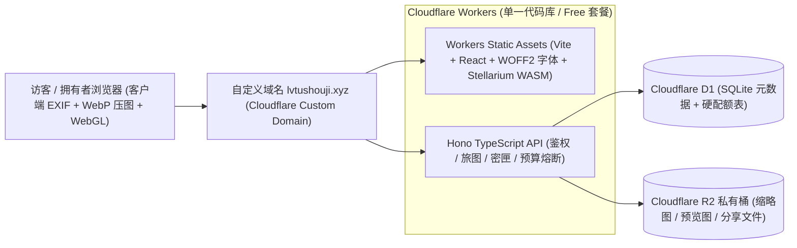

# 个人网站构建总方案 · 「谷歌克制之骨 × 旅途与星穹之魂」

> **目标目录**：`./`（本地与云端统一工程根目录）  
> **文档用途**：可直接交付新对话按阶段实施的完整产品、视觉、动效、架构与部署蓝图。  
> **核心原则**：**先精雕质感与通路，再逐层点亮功能；绝不再造重型工程空壳。**

---

## 1. 产品定位与边界（吸取前两版教训，严控范围）

### 1.1 一句话定位
**个人门面 + 独立实验馆**：对外是一张极有审美辨识度与个人温度的数字名片，围绕**旅行影像地图、实时星图、私密文件口令分享**三大核心能力构成统一的空间叙事，同时预留「实验馆 Labs」插槽以便未来低成本挂接新玩具。

### 1.2 核心范围（只做这 4 块）
1. **个人门面（Home / Observer）**：极简顶栏、融合物理星环与实景画幅的首屏、个人简介、三大核心模块的沉浸入口与未来 Labs 扩展位。
2. **旅图（Atlas）**：以 **2.5D 交互地图（MapLibre GL JS）** 为主角的旅行足迹与原比例摄影手记，支持线路绘制、沿途回放、骨白留白装裱、日期邮戳、原生暗房大图、私密/公开控制，以及客户端 EXIF 解析 + WebP 自动压图上传。
3. **实时星图（Observatory）**：完全本地同源的 **Stellarium Web Engine WASM** 沉浸星图 + 923 颗亮星方位图降级方案；支持自由拖拽、中英文搜索、观测时刻滑块（周日视运动），并与「旅图」实现招牌联动——**一键「回望此地当夜星空」**（将照片的拍摄经纬度与时间直接带入星图）。
4. **文件密匣（Vault）**：Gemini 风格极简居中提取胶囊（输入 6 位口令直达原件）+ 后台分片上传至私有 R2 + 限时/限次/口令/本地 SVG 二维码/一键撤销墓碑，新上传默认私密。

### 1.3 明确砍掉的冗余（禁止再引入）
- ❌ AI 对话与多模态文件分析队列（不再依赖本机 OpenClaw 代理）
- ❌ 12 合一在线工具箱、本地 FFmpeg 转码
- ❌ 五款小游戏（未来需要时可作为独立子页挂进 Labs，首版不耦合）
- ❌ 沉重的 Cesium 3D 地球、全屏 SVG 液态玻璃置换滤镜、8 章滚轮劫持
- ❌ 本机 SQLite + 云端 D1 双套后端并行维护、桌面 `.exe` 控制台与内网穿透

---

## 2. 视觉与动效设计规范（路线 1 × 路线 2 融合 + 严防 AI 味）

### 2.1 首屏融合架构：「Antigravity 物理星环 × DeepMind 电影画幅」
解决纯白首屏“空而平”与纯暗黑首屏“重而炫”的矛盾，采用 **100vh 上下联动构图**：

1. **上半屏（约 58% 视口高）—— Google Antigravity 物理纯净空间**：
   - 背景不是惨白平板，而是带有极微弱工作室环境光层次的画布（亮色 `#FFFFFF → #F6F8FB`，暗色 `#131314 → #0C0D0F`）。
   - **WebGL GLSL 自定义着色器粒子星环**（`ogl` 或轻量化 `three` 自定义 `ShaderMaterial`）：
     - 形态致敬旧版 `secret` 的**倾斜行星星环**，但以 **2,500–4,000 颗不同尺度的柔光微粒**渲染，具备真实景深虚化（Bokeh）、3D Curl Noise 失重缓慢流动、光标实时斥力/涡旋物理、点击引力波扩散。
     - 色彩极度克制：静止时为极淡的中性银灰/冷雾灰（完全不抢文字清晰度），仅在光标扰动与轨道波峰处泛出柔和的谷歌蓝（`#4285F4` / `#8AB4F8`）与极微暖星光金（`#C99672`）。
   - 中央排印：自托管高阶 WOFF2 字体，克制的 `500` 中等字重、紧字距 `-0.03em`、温暖说人话的一句主标题（如：`把走过的山海，和看过的夜空收进一册。`）+ 一行副标 + 两个经过像素级微抛光的纯色/轻雾胶囊按钮。
2. **下半屏（约 42% 视口高）—— DeepMind / Apple 高精度电影画幅锚点（Focal Anchor）**：
   - **首屏不留空底**：紧贴按钮下方，一块 32px 超大圆角、宽幅（max-width `1280px`）的**高精度实景摄影 / 实时 2.5D 地图光影舞台**在首屏下沿自然露头，立刻给整个页面压住高级感与质感重心。
   - **原生 CSS 滚动驱动展开（Scroll-Driven Animations）**：用户自然向下滚动时，该画幅通过 `animation-timeline: view()` 从 `scale(0.94)` 平滑铺展至完整宽幅视窗，零 JS 滚轮劫持、60–120fps 跟手。

### 2.2 昼夜双态色彩体系（纯正谷歌色盘 × 旅行册温度）

采用现代 CSS `color-scheme` + `light-dark()`（带 `@supports` 回退），支持一键或跟随系统切换，且**星图与照片暗房通过 `color-scheme: only dark` 永远保持纯净深空**：

| 语义角色 | 日光纸感（Antigravity / Gemini 亮色） | 深夜暗房（AI Studio / DeepMind 暗色） | 用途与克制规则 |
| :--- | :--- | :--- | :--- |
| 页面主底色 | `#FFFFFF`（柔光边缘 `#F6F8FB`） | `#131314`（柔光边缘 `#0C0D0F`） | 绝不用俗气的蓝黑 `#07090D` |
| 表面层（无框分层） | `#F2F4F8` / 悬浮 `#E8EDF4` | `#1E1F20` / 悬浮 `#282A2C` | 靠色阶区分层次，不给每张卡画亮边框 |
| 照片装裱纸面 | `#FAF8F4`（骨白相纸感） | `#222427`（暗房卡纸感） | 仅用于旅图摄影装裱与文件签条 |
| 主文字 / 辅助文字 | `#1F1F1F` / `#5F6368` | `#E3E3E3` / `#9AA0A6` | 满足 WCAG AA/AAA 对比度 |
| 主按钮（胶囊） | `#1F1F1F` 底 + `#FFFFFF` 字 | `#E3E3E3` 底 + `#131314` 字 | 精调内边距、1px 细腻光学高光与弹簧按压 |
| 唯一交互强调色 | `#1A73E8`（Google Blue） | `#8AB4F8`（Dark Mode Blue） | 用于路线进度、焦点环、上传进度条 |
| 个人印记点缀色 | `#9A5B42`（暖赭邮戳色） | `#D69F87`（柔暖陶色） | **仅**用于日期邮戳与私人附言，绝不滥用 |
| 恒定深空视窗 | `#0B0C0E`（`color-scheme: only dark`） | `#0B0C0E` | 观星台与全屏暗房灯箱，亮模式下亦不刺眼 |

### 2.3 排版与字体硬性规范（根治 Windows 微软雅黑廉价感）
- **严禁依赖系统默认微软雅黑渲染大标题！**
- **自托管静态字体子集（WOFF2，存放在 `public/fonts/`，长期缓存 `immutable`）**：
  - 中文无衬线主字体：`MiSans VF` / `HarmonyOS Sans SC` / `思源黑体 (Source Han Sans SC)`（打包常用 3500–5000 字子集，单字重控制在 250–450KB，或使用按 Unicode Range 分片的静态 WOFF2）。
  - 人文手记衬线（仅用于短句/旅记正文点缀）：`思源宋体 (Source Han Serif SC)` 轻量子集。
  - 西文与精密数字：`Inter`（或 `Plus Jakarta Sans`）+ `JetBrains Mono`（开启 `font-variant-numeric: tabular-nums`，仅用于经纬度、EXIF、星等、字节数）。
- **字重与字距**：大标题使用 `font-weight: 500`（严禁 `400` 发虚或 `800+` 笨重）、`letter-spacing: -0.03em`、`line-height: 1.14`；正文 `15–16px`、`line-height: 1.75`。

### 2.4 六条「反 AI 味」开发红线（必须严格执行）
1. **零 AI 装饰符号**：全站禁用 `✦`、`✨`、`🚀` 等 emoji/星号前缀；禁用 `01 / ATLAS`、`02 / VAULT` 式大写等宽编号 kicker；禁用无意义的脉冲绿点与满屏小胶囊标签。
2. **零廉价暗黑特效**：禁用霓虹金/青双色描边、禁用卡片边缘光标径向高光（spotlight border）、禁用拥挤的四格 SaaS Bento 仪表盘。
3. **零粗糙 2D 假粒子**：背景粒子必须用 **WebGL GLSL Shader** 渲染真实柔焦微粒与体积层次；不支持 WebGL 或低功耗/减少动态偏好时直接回退为细腻静态光学背景，严禁用 2D `lineTo` 粗灰短线凑数。
4. **文案去中二化**：使用克制、松弛、有真实体温的中文短句（继承 `aaa/src/components/travel/chapter-copy.ts` 的语感），绝不写“密钥解封”“时空遥测协议”等悬浮科幻词。
5. **现代原生 Web 动效优先**：
   - 照片切换、卡片展开、日夜切换优先使用 **View Transitions API**（带清理 `view-transition-name` 与焦点迁移，降级直接切状态）。
   - 滚动揭幕优先使用 **CSS Scroll-Driven Animations**（`@supports ((animation-timeline: view()) and (animation-range: entry))`，无 polyfill，不劫持滚轮）。
   - 全屏暗房灯箱使用原生 `<dialog closedby="any">` + `showModal()` + `overscroll-behavior: contain` + `@starting-style` / `allow-discrete`（补齐 Safari `closedBy` 与退场回退）。
   - 所有持续运行动画必须提供清晰可见的暂停开关，页面切后台（`document.hidden`）自动停帧。
6. **强制视觉验收门禁**：每个阶段完成后，必须用真实浏览器截取 **1440×900 桌面**与 **390×844 手机**（亮色 + 暗色）实景截图并逐项核对字体加载、粒子细腻度、留白比例与照片色彩，绝不盲写盲交付。

---

## 3. 核心模块与灵魂交互设计

### 3.1 旅图 · Atlas（地图为主角 + 实体旅行册温度）
- **交互地图（MapLibre GL JS）**：
  - 桌面态采用宽幅非对称分栏（左约 62% 2.5D 交互地图，右约 38% 装裱手记卡）；手机端采用流畅底抽屉 + 地图保留可视区。
  - 底图支持天地图 / 开源矢量暗亮双风格，并内置极简离线 GeoJSON 轮廓降级，确保任何网络环境都不会白屏。
  - 路线采用平滑贝塞尔航迹 + 进度推进，支持**「沿途回放」**（自动按站推进、随时暂停/手动接管）。
- **装裱手记与暗房灯箱**：
  - 照片保持原始宽高比与自然色彩，套以微暖骨白相纸装裱边、一枚克制的圆形暖赭日期邮戳、两行宋体手记与真实 EXIF 参数（焦段、光圈、快门、ISO、经纬度）。
  - 点击照片触发原生 `<dialog>` 暗房灯箱，支持滚轮/双指缩放、平移、键盘左右切图与原位焦点返回。
- **客户端预处理上传（彻底解决旧版云端无缩略图痛点）**：
  - 浏览器选择照片后，本地用 `exifr` 自动提取拍摄时间、GPS 与相机参数（确认后才落库，无 GPS 归入待定位，绝不虚构坐标）。
  - 浏览器直接通过 `Canvas / OffscreenCanvas` 编码生成 **600px WebP 缩略图** + **1600px WebP 预览图**，连同可选原图一起分片/直传至私有 R2，节省约 80% 流量与存储，无需服务端 Sharp。

### 3.2 实时星图 · Observatory（零外部依赖 + 时空联动）
- **资产直接复用**：复用本地同源 Stellarium Web Engine WASM + 星表（`public/stellarium/`），以及 `astronomy-engine` 923 颗亮星方位图作为降级/轻量模式（零第三方在线依赖，国内秒开）。
- **极简天文 HUD**：全幅 32px 圆角纯黑视窗（`color-scheme: only dark`），支持鼠标/触控平滑拖动、中英文星体与 88 星座搜索、星座线/地景/名称独立开关，以及 **19:00 → 04:00 观测时刻滑块**。
- **招牌联动「回望当夜星空」**：点击旅图中任意一站的「查看当夜星空」，自动把该站经纬度与拍摄日期时间传入星图，呈现按下快门那晚头顶的真实星空。

### 3.3 文件密匣 · Vault（极简口令分享）
- **前台体验**：Gemini 风格居中大圆角提取胶囊（支持键盘回车直接校验），输入 6 位口令后平滑滑出一张带相纸温度的简约签条——展示文件名、体积、剩余下载次数、过期倒计时、一句可选附言、本地生成的高清 SVG 二维码与一键下载按钮。
- **上传与管理**：私密控制台内支持拖拽分片上传（带断点重试与取消）、设置有效期/次数/自定义口令、一键撤销（保留撤销墓碑防旧链接误复用）。所有原件存放在私有 R2，仅通过 Worker 签发短期票据或鉴权流式下发。

---

## 4. 技术栈与单一云原生架构

彻底告别旧版“本机 SQLite + Next.js 静态导出魔改 + 手写裸 Worker”的分裂痛苦，采用 **一套代码、本地与云端 100% 一致** 的 Cloudflare 原生架构：

| 层级 | 推荐选型 | 说明 |
| :--- | :--- | :--- |
| **前端工程** | **Vite 6 + React 19 + TypeScript** | 构建秒级、无 SSR/静态导出水合坑、天然按路由拆包懒加载（MapLibre、WebGL、Stellarium 独立 chunk，首屏极轻）。 |
| **样式与动效** | **Tailwind CSS v4 + CSS Modules + Motion + 原生 View Transitions / CSS Scroll-Driven** | 清晰 Design Tokens，杜绝单文件巨型 CSS。 |
| **WebGL 粒子** | **OGL（~8KB gzip）或轻量化 Three.js 自定义 GLSL Shader** | 优先 OGL，体积极小、零冗余、轻松跑满 60–120fps 高密度 Bokeh 粒子场。 |
| **地图引擎** | **MapLibre GL JS** | 支持 2.5D 倾斜视角、丝滑飞行相机、自定义日/夜风格与离线矢量兜底。 |
| **后端 API** | **Hono + `@cloudflare/vite-plugin`** | Cloudflare 官方首推；`npm run dev` 本地直接模拟真实 D1 与 R2，一套代码无缝部署线上。 |
| **认证与安全** | **单人管理员口令 + PBKDF2/WebCrypto + HttpOnly SameSite Cookie + CSRF** | 延续 `aaa` 安全边界；公开 API 仅吐出显式公开的旅程，私有媒体不走公开桶。 |
| **费用保护** | **D1 原子硬预算熔断** | 实现于 `src/server/middleware/cost-limits.ts`：累计上传上限 2 GiB、月 API 20,000 次、R2 A 类 10,000 次、B 类 100,000 次，超额前直接拒绝，配合 \$0.01 USD 账单预警确保零意外扣费。 |

---

## 5. 可直接复用的现有云端与本地资产清单

新对话实施时可直接读取/迁移以下资产（**只读参考，不修改旧目录**）：

1. **Cloudflare 账号与域名基建**（参考历史归档配置）：
   - Account ID：`<CLOUDFLARE_ACCOUNT_ID>`（Workers Free 套餐，已开通 R2 订阅与 \$0.01 USD 账单预警）
   - 已注册自定义域名：`lvtushouji.xyz`（Cloudflare Free Zone ID `<CLOUDFLARE_ZONE_ID>`，NS 已配置为 `<assigned Cloudflare nameservers>`）
   - 生产资源绑定（新建独立数据库与私有存储桶）：D1 `lvtushouji-db`（`<D1_DATABASE_ID>`）、私有 R2 `lvtushouji-media`。
2. **本地同源星图资产**：
   - `public/stellarium/`（WASM 引擎与星表）
   - `public/stellarium/NOTICE.txt`（上游许可与出处说明）
   - `src/client/features/observatory/BrightStarChart.tsx`（923 颗亮星降级方位图）
3. **开发期演示摄影素材**（仅用于本地视觉验收，严禁作为真实数据写入生产库）：
   - `public/demo/`（`road.jpg`, `mountain.jpg`, `lake.jpg`, `forest.jpg`）
4. **业务逻辑参考**：
   - 费用熔断与安全会话：`src/server/middleware/cost-limits.ts`、`security.ts`
   - 分片上传与口令分享语义：`src/server/routes/vault.ts`

---

## 6. 五阶段实施路线图（严格按序验收，不跳步）

### Phase 0：通路验证与工程地基（先通公路，再盖房子）
- 在项目根目录初始化 `Vite 6 + React 19 + TS + Tailwind v4 + Hono + @cloudflare/vite-plugin`。
- 核验 `lvtushouji.xyz` Cloudflare Zone 是否已变为 `Active`，先部署最小占位页绑定 Custom Domain，并用国内多线路测试真实连通性（如国内访问不理想，在此阶段即刻评估补充方案，绝不拖到最后）。
- 配置自托管 WOFF2 字体子集（中文无衬线 + 宋体点缀 + 等宽数字），建立日/夜 Design Tokens。

### Phase 1：旗舰首屏 + 旅图一屏「画质定标」（视觉验收核心关）
- **只做首屏 + 旅图展示区**，但直接做到成品级画质：
  - 基于 OGL WebGL GLSL 的倾斜星环高密度 Bokeh 粒子场（含鼠标物理交互与暂停开关）。
  - 首屏下沿自然承接的 DeepMind 级大画幅实景锚点 + CSS Scroll-Driven 平滑展开。
  - 真实 MapLibre GL JS 2.5D 交互路线地图 + 装裱照片卡 + 暖赭邮戳 + 沿途回放 + 原生 `<dialog>` 暗房灯箱。
- **阶段验收门禁**：真浏览器截图核对 1440×900 / 390×844 的日/夜双态，确认**零微软雅黑回退、零粗糙感、零 AI 味**，用户拍板通过后再进 Phase 2！

### Phase 2：旅图完整闭环 & 写入你的第一批真实照片
- 完成 D1 表结构、单口令管理员登录（HttpOnly Cookie + CSRF）、D1 硬预算熔断器。
- 实现后台/整理台：浏览器端 `exifr` 解析 + Canvas 自动生成 600px / 1600px WebP 缩略图直传私有 R2、私密/公开切换、地点确认与排序。
- **里程碑**：立刻上传并发布你的**第一组真实旅行照片**，彻底打破“零内容魔咒”。

### Phase 3：观星台 Observatory & 时空联动
- 按需懒加载本地同源 Stellarium WASM 引擎与亮星降级图，套用极简纯黑天文 HUD 与 19:00–04:00 时刻滑块。
- 打通「从旅图站点一键回望当夜星空」的坐标与时间透传。

### Phase 4：密匣 Vault & 正式上线收尾
- 实现后台文件分片直传 R2、分享票据生成（6 位口令 + TTL + 次数上限 + 本地 SVG 二维码 + 附言 + 一键撤销墓碑）。
- 实现前台 Gemini 风格居中提取胶囊与纸感签条下载体验。
- 上线生产环境，完成桌面与真机手机全链路回归检查（含用量面板与一键导出备份）。
